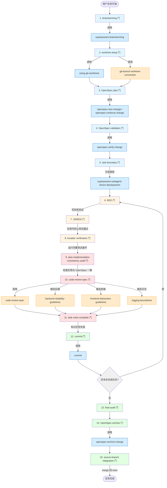

# Development Workflow 使用指南

> `development-workflow` 是本仓库的**流程编排 skill**，它不定义具体规范，只负责在固定的 25 步任务循环里调度其他 skill。理解它如何组合本地 + 外部 skill 是用好整套规范的关键。

---

## 一、它是什么

`development-workflow` 强制执行一个固定循环：

```
brainstorm → OpenSpec 建 change → 独立 worktree → TDD RED/GREEN → 
一致性审计 → code-review → 逐任务提交 → OpenSpec 归档
```

### 可视化流程图（25 步完整循环）



**图例**：
- 🔵 **蓝色方框**（门禁）：workflow 定义的检查点，决定能否进入下一步
- 🔵 **蓝色圆角框**（外部 skill）：需要从公网/内部镜像单独安装
- 🟠 **橙色圆角框**（本仓库 skill）：跟随本仓库安装
- 🔄 **循环**：G6-G13 形成任务内循环（RED → GREEN → review → commit → 下一任务）

**它本身不管**：
- 分支怎么命名（委托给 `git-branch-worktree-convention`）
- 代码注释占比几成（委托给 `code-review-spec`）
- 日志脱敏字段清单（委托给 `logging-boundaries`）
- 删除按钮是否红色（委托给 `frontend-interaction-guidelines`）
- 幂等键怎么设计（委托给 `backend-reliability-guidelines`）

**它只管**：
- 什么时候调哪个 skill（在"worktree-setup"门调 `git-branch-worktree-convention`，在"code-review-spec"门调 `code-review-spec`）
- 门禁通过条件（RED 门要求测试失败，GREEN 门要求测试通过）
- 任务顺序（brainstorm 必须在 OpenSpec plan 前，commit 必须在 code-review 后）

---

## 二、它组合了哪些 skill

### 本仓库内置（7 个）

这些 skill 跟随本仓库安装，无需额外下载：

| Skill | 在哪个阶段调用 | 职责 |
|------|--------------|------|
| [`git-branch-worktree-convention`](./git-branch-worktree-convention/SKILL.md) | worktree-setup 门 | 首次确认集成分支，验证 task 分支名（emoji 前缀 ✅ + 中文），记录 SOURCE_BRANCH，确保原 checkout 隔离 |
| [`commit`](./commit/SKILL.md) | commit 门 | 中文 Conventional Commit + emoji 前缀 + body/footer 非空 |
| [`code-review-spec`](./code-review-spec/spec.md) | code-review-spec 门 | 检查 `@author`、方法长度、注释占比、命名、异常处理、日志、SQL、Git 提交格式 |
| [`backend-reliability-guidelines`](./backend-reliability-guidelines/SKILL.md) | 触及后端 API/Service/Job/迁移时自动 | 幂等、事务、并发、迁移、环境隔离、fail-fast、错误契约、业务审计、可观测性 |
| [`frontend-interaction-guidelines`](./frontend-interaction-guidelines/SKILL.md) | 触及前端页面/表单/按钮时自动 | 防重、乐观更新、loading/empty/error/disabled 一致性、删除确认、破坏性视觉 |
| [`logging-boundaries`](./logging-boundaries/SKILL.md) | 触及日志代码时自动 | traceId 强制、脱敏、MDC 跨线程、Actuator 热开、级别语义 |
| [`ddd`](./ddd/SKILL.md) | 领域建模讨论时手动调用 | Bounded Context、聚合边界、Entity/VO/Domain Event/Repository、四层架构 |

**安装方式**：按 [README 安装章节](./README.md#安装) 三种方式任选一种，这 7 个 skill 会一起装进 `~/.claude/skills/`。

---

### 外部依赖（必须单独安装）

这些 skill **不在本仓库里**，需要从公网或内部源单独获取：

| Skill 套件 | 来源 | 在哪个阶段调用 | 职责 |
|-----------|------|--------------|------|
| **superpowers 套件** | https://github.com/cline/superpowers (或内部镜像) | brainstorming 门 + subagent-driven-development 门 | 需求讨论、多 agent 编排原则 |
| **OpenSpec 套件** | https://github.com/spec-dev/openspec-skills (或内部镜像) | OpenSpec plan 门 + OpenSpec validation 门 + OpenSpec archive 门 | 创建/继续/归档 OpenSpec change、验证一致性 |
| **using-git-worktrees** | https://github.com/git-worktrees/claude-skill (或内部镜像) | worktree-setup 门（与 `git-branch-worktree-convention` 配合） | worktree 创建机制、目录选择、安全校验 |

**安装方式示例**（假设你用 git clone 方式）：

```bash
# 1. 安装 superpowers 套件
cd ~/.claude/skills
git clone https://github.com/cline/superpowers.git

# 2. 安装 OpenSpec 套件
git clone https://github.com/spec-dev/openspec-skills.git
ln -sfn openspec-skills/openspec-new-change openspec-new-change
ln -sfn openspec-skills/openspec-continue-change openspec-continue-change
ln -sfn openspec-skills/openspec-ff-change openspec-ff-change
ln -sfn openspec-skills/openspec-verify-change openspec-verify-change
ln -sfn openspec-skills/openspec-archive-change openspec-archive-change

# 3. 安装 commit 和 using-git-worktrees
git clone https://github.com/anthropics/commit-skill.git commit
git clone https://github.com/git-worktrees/claude-skill.git using-git-worktrees
```

**注意**：上述 GitHub URL 是示意，实际地址请查各 skill 的官方仓库或你们内部 git 镜像地址。如果你的环境无法访问公网，请联系管理员获取内部镜像或离线包。

### 外部 skill 详细安装步骤

#### 1. superpowers 套件

**作用**：提供 `brainstorming` 和 `subagent-driven-development` 两个 skill。

**安装方式 A：从官方源**

```bash
cd ~/.claude/skills

# 方式 1：Git clone（推荐，便于更新）
git clone https://github.com/cline/superpowers.git

# 方式 2：下载 zip 解压
curl -LO https://github.com/cline/superpowers/archive/refs/heads/main.zip
unzip main.zip && mv superpowers-main superpowers
```

**安装方式 B：从内部镜像**（如果你的环境无公网）

```bash
# 假设你们有内部 GitLab
git clone https://gitlab.your-company.com/claude-skills/superpowers.git ~/.claude/skills/superpowers
```

**验证**：

```bash
ls ~/.claude/skills/superpowers/{brainstorming,subagent-driven-development}/SKILL.md
# 应该看到两个 SKILL.md 文件
```

---

#### 2. OpenSpec 套件

**作用**：提供 `openspec-new-change`、`openspec-continue-change`、`openspec-ff-change`、`openspec-verify-change`、`openspec-archive-change` 五个 skill。

**安装**：

```bash
cd ~/.claude/skills

# Step 1: Clone OpenSpec 套件仓库
git clone https://github.com/spec-dev/openspec-skills.git

# Step 2: 为每个 skill 创建软链接（因为 Claude Code 需要顶级目录就是 skill 名）
ln -sfn openspec-skills/openspec-new-change openspec-new-change
ln -sfn openspec-skills/openspec-continue-change openspec-continue-change
ln -sfn openspec-skills/openspec-ff-change openspec-ff-change
ln -sfn openspec-skills/openspec-verify-change openspec-verify-change
ln -sfn openspec-skills/openspec-archive-change openspec-archive-change

# 或者用循环批量创建
for skill in openspec-new-change openspec-continue-change openspec-ff-change \
             openspec-verify-change openspec-archive-change; do
  ln -sfn openspec-skills/$skill $skill
done
```

**为什么要软链接**？

OpenSpec 套件结构是：
```
openspec-skills/
├── openspec-new-change/
├── openspec-continue-change/
├── openspec-ff-change/
├── openspec-verify-change/
└── openspec-archive-change/
```

但 Claude Code 扫描 `~/.claude/skills/` 时期望顶级就是 skill 名（例如 `~/.claude/skills/openspec-new-change/SKILL.md`），所以需要软链接把 5 个子目录"提升"到顶级。

**验证**：

```bash
ls -l ~/.claude/skills/openspec-*
# 应该看到 5 个软链接，都指向 openspec-skills/<对应子目录>

ls ~/.claude/skills/openspec-new-change/SKILL.md
ls ~/.claude/skills/openspec-archive-change/SKILL.md
# 应该能读到 SKILL.md
```

---

#### 3. using-git-worktrees skill

**作用**：提供 worktree 创建机制、目录选择、安全校验（与本仓库的 `git-branch-worktree-convention` 配合）。

**安装**：

```bash
cd ~/.claude/skills

# Git clone
git clone https://github.com/git-worktrees/claude-skill.git using-git-worktrees
```

**验证**：

```bash
ls ~/.claude/skills/using-git-worktrees/SKILL.md
```

---

### 一键安装脚本（公网环境）

如果你的开发环境**有公网访问**，可以用这个脚本一次装完 3 套外部 skill：

```bash
#!/bin/bash
# install-external-skills.sh

set -e
cd ~/.claude/skills

echo "==> 1. 安装 superpowers..."
if [ ! -d "superpowers" ]; then
  git clone https://github.com/cline/superpowers.git
  echo "✓ superpowers 安装完成"
else
  echo "⊘ superpowers 已存在，跳过"
fi

echo ""
echo "==> 2. 安装 OpenSpec 套件..."
if [ ! -d "openspec-skills" ]; then
  git clone https://github.com/spec-dev/openspec-skills.git
  
  # 创建软链接
  for skill in openspec-new-change openspec-continue-change openspec-ff-change \
               openspec-verify-change openspec-archive-change; do
    ln -sfn openspec-skills/$skill $skill
  done
  echo "✓ OpenSpec 套件安装完成（5 个 skill）"
else
  echo "⊘ openspec-skills 已存在，跳过"
fi

echo ""
echo "==> 3. 安装 using-git-worktrees..."
if [ ! -d "using-git-worktrees" ]; then
  git clone https://github.com/git-worktrees/claude-skill.git using-git-worktrees
  echo "✓ using-git-worktrees 安装完成"
else
  echo "⊘ using-git-worktrees 已存在，跳过"
fi

echo ""
echo "==> 全部外部 skill 安装完成！"
echo ""
echo "验证安装："
echo "  ls ~/.claude/skills/{superpowers,openspec-new-change,openspec-archive-change,using-git-worktrees}/SKILL.md"
```

**使用**：

```bash
chmod +x install-external-skills.sh
./install-external-skills.sh
```

---

### 离线环境安装

如果开发环境**无法访问公网**：

#### Step 1：在有网机器上打包

```bash
# 有网机器
cd /tmp
mkdir claude-external-skills
cd claude-external-skills

git clone https://github.com/cline/superpowers.git
git clone https://github.com/spec-dev/openspec-skills.git
git clone https://github.com/git-worktrees/claude-skill.git using-git-worktrees

cd ..
tar -czf claude-external-skills.tar.gz claude-external-skills/
```

#### Step 2：传到离线机器

```bash
# 通过 U 盘、内网文件服务器、或 scp 传输
scp claude-external-skills.tar.gz user@offline-machine:/tmp/
```

#### Step 3：离线机器解压安装

```bash
# 离线机器
cd /tmp
tar -xzf claude-external-skills.tar.gz
cd claude-external-skills

# 移动到 ~/.claude/skills/
mv superpowers ~/.claude/skills/
mv openspec-skills ~/.claude/skills/
mv using-git-worktrees ~/.claude/skills/

# 创建 OpenSpec 软链接
cd ~/.claude/skills
for skill in openspec-new-change openspec-continue-change openspec-ff-change \
             openspec-verify-change openspec-archive-change; do
  ln -sfn openspec-skills/$skill $skill
done

echo "离线安装完成"
```

---

### 版本管理与更新

**推荐做法**（团队协作）：

1. **锁定版本**：在有网机器上 clone 后，记录每个仓库的 commit hash：

```bash
cd ~/.claude/skills/superpowers && git rev-parse HEAD
cd ~/.claude/skills/openspec-skills && git rev-parse HEAD
cd ~/.claude/skills/using-git-worktrees && git rev-parse HEAD
```

把这 3 个 commit hash 写进团队文档（例如本仓库的 `EXTERNAL_SKILL_VERSIONS.md`），全员安装时 checkout 到同一 hash：

```bash
cd ~/.claude/skills/superpowers
git fetch origin
git checkout <记录的 commit hash>
```

2. **定期更新**（例如每月）：

```bash
cd ~/.claude/skills/superpowers && git pull
cd ~/.claude/skills/openspec-skills && git pull
cd ~/.claude/skills/using-git-worktrees && git pull

# 更新后重新记录 commit hash，通知全员同步
```

3. **测试兼容性**：更新外部 skill 后，跑一个小任务测试 `development-workflow` 是否仍能正常走完 25 步循环。

---

## 三、完整依赖树

```
development-workflow (本仓库, 流程编排器)
│
├─ 本仓库内置 skill (跟随本仓库安装)
│  ├─ git-branch-worktree-convention
│  ├─ commit
│  ├─ code-review-spec
│  ├─ backend-reliability-guidelines
│  ├─ frontend-interaction-guidelines
│  ├─ logging-boundaries
│  └─ ddd
│
└─ 外部 skill (需单独安装)
   ├─ superpowers:brainstorming
   ├─ superpowers:subagent-driven-development
   ├─ openspec-new-change
   ├─ openspec-continue-change
   ├─ openspec-ff-change
   ├─ openspec-verify-change
   ├─ openspec-archive-change
   └─ using-git-worktrees
```

---

## 四、检查依赖是否就位

安装完本仓库 + 外部 skill 后，用以下命令验证：

```bash
# 检查本仓库 7 个 skill
ls ~/.claude/skills/{git-branch-worktree-convention,commit,code-review-spec,backend-reliability-guidelines,frontend-interaction-guidelines,logging-boundaries,ddd}/SKILL.md

# 检查外部依赖
ls ~/.claude/skills/{superpowers,openspec-new-change,openspec-continue-change,openspec-ff-change,openspec-verify-change,openspec-archive-change,using-git-worktrees}/SKILL.md
```

如果任一文件不存在，说明对应 skill 未安装或路径不对，`development-workflow` 会在运行到对应门时报错 "skill unavailable"。

---

## 五、如何使用

### 自动触发（推荐）

`development-workflow` 的 `description` 覆盖了"涉及代码、测试、文档、配置、重构或提交的任务"，Claude Code 会自动匹配。直接告诉它任务即可：

```
帮我实现用户下单接口
```

Claude Code 会：
1. 自动加载 `development-workflow`
2. 进入 brainstorming 门 → 调 `superpowers:brainstorming`
3. 进入 OpenSpec plan 门 → 调 `openspec-new-change`
4. 进入 worktree-setup 门 → 调 `using-git-worktrees` + `git-branch-worktree-convention`
5. ... 按 25 步循环走完

### 显式调用

```
/development-workflow 我要重构订单模块
```

强制走完整流程，即使任务看起来很小。

---

## 六、常见问题

### Q1：我只想审代码，不想走完整流程，能跳过 development-workflow 吗？

**可以**。直接调 `/code-review-spec`：

```
/code-review-spec 审下这段 Java 代码
```

这样只触发代码审查，不触发 brainstorm、OpenSpec、worktree 等流程。

---

### Q2：我已经建好分支了，development-workflow 还会重新建吗？

**不会**。`development-workflow` 在 worktree-setup 门检查当前是否已在合规 worktree 里，如果是就跳过创建步骤。但它仍会调 `git-branch-worktree-convention` 验证分支名是否符合 emoji 前缀规则。

---

### Q3：我的项目不用 OpenSpec，能关掉吗？

**不推荐，但可以**。`development-workflow/SKILL.md` 顶部有一句：

> OpenSpec remains mandatory by default for every persisted change unless the user explicitly opts out.

如果你明确不用 OpenSpec，在每次任务开始时告诉 Claude：

```
这个任务跳过 OpenSpec，直接写代码
```

但这样会失去变更追溯能力，代码审查时也没有"计划 vs 实现一致性"校验。

---

### Q4：external skill 的 GitHub 地址都是 404，怎么办？

**两个原因**：
1. 本文档示例 URL 是占位符，实际地址请查官方文档或内部 wiki
2. 你的环境无公网访问，需要用内部镜像或离线包

请联系团队管理员获取正确的安装源。

---

### Q5：我装了本仓库 6 个 skill，但 development-workflow 还报 "backend-reliability-guidelines unavailable"

**排查步骤**：

1. 确认路径：`ls ~/.claude/skills/backend-reliability-guidelines/SKILL.md`
2. 确认权限：`ls -l ~/.claude/skills/backend-reliability-guidelines/`（需要可读）
3. 确认软链接（如果用方式二安装）：`readlink ~/.claude/skills/backend-reliability-guidelines`（应指向本仓库路径）
4. 重启 Claude Code：skill 索引可能未刷新

---

### Q6：我能只装 development-workflow，不装其他 6 个吗？

**技术上可以，但会频繁报错**。`development-workflow` 在 code-review-spec 门、worktree-setup 门、Domain Authority Delegation 表里硬引用了其他 6 个 skill。不装的话：
- worktree-setup 门报 `git-branch-worktree-convention unavailable`
- code-review-spec 门报 `code-review-spec unavailable`
- 触及后端代码时报 `backend-reliability-guidelines unavailable`

建议**全装**，即使某些 skill 暂时用不到（例如 `ddd` 只在领域建模时用），也占不了多少空间。

---

## 七、最佳实践

### 初次使用

1. **先装本仓库 6 个 skill**（按 [README 安装章节](./README.md#安装)）
2. **再装外部 4 套 skill**（superpowers / OpenSpec / commit / using-git-worktrees）
3. **验证依赖**（见上文"四、检查依赖是否就位"）
4. **跑一个小任务测试**：
   ```
   /development-workflow 写一个 hello world 函数并测试
   ```
   如果 25 步门全部通过，说明环境就位。

### 团队协作

- **统一安装源**：团队用同一套外部 skill 版本（锁 commit hash 或 tag），避免"你的 commit skill v1.2 我的 v1.5"导致提交格式分裂
- **共享配置**：把本仓库作为 git submodule 加到项目 `.claude/skills/` 下，全员自动同步规范更新
- **定期同步**：本仓库更新后（例如新增红线、修复冲突），通知全员 `git pull` 或 `git submodule update`

### 离线环境

如果开发环境无公网访问：
1. 在有网机器上 `git clone` 所有外部 skill 到本地
2. 打包成 `.tar.gz`
3. 传到离线机器，解压到 `~/.claude/skills/`
4. 定期（例如每月）从有网机器更新包

---

## 八、进阶：自定义门禁

`development-workflow` 的 25 步循环是固定的，但你可以通过修改 `development-workflow/SKILL.md` 调整门禁条件。例如：

### 关闭 TDD 强制（不推荐）

找到 `## Mandatory Task Loop` 的 RED 门条款：

```markdown
- RED: Write failing focused tests first...
```

改为：

```markdown
- RED: Write focused tests (failing or passing)...
```

但这样会失去"测试先行"的约束。

### 简化 S-tier 任务的审计深度

找到 `## Risk-Based Standard Change Tiers` 的 S-tier 定义：

```markdown
- S-tier: trivial documentation fix, typo, comment, log message, or single-line
  non-behavior change. Use a compact OpenSpec change by default, but use compact
  proposal, design, task, spec, verification, and review evidence.
```

改为：

```markdown
- S-tier: ... Use a single-task OpenSpec change with minimal evidence.
```

---

## 九、与其他 skill 的职责边界

| 问题 | 归属 skill | 不归属 |
|------|-----------|--------|
| 分支名要不要 emoji？ | `git-branch-worktree-convention` | ❌ `development-workflow` 不管 |
| 什么时候建分支？ | `development-workflow` (worktree-setup 门) | ❌ `git-branch-worktree-convention` 不管 |
| 提交信息格式？ | `commit` | ❌ `development-workflow` 不管 |
| 什么时候提交？ | `development-workflow` (commit 门) | ❌ `commit` 不管 |
| 日志是否脱敏？ | `logging-boundaries` | ❌ `code-review-spec` 不管 |
| 什么时候检查日志？ | `development-workflow` (code-review-spec 门 + Domain Authority Delegation) | ❌ `logging-boundaries` 不管 |

**记住一条**：`development-workflow` 只管"什么时候调谁"，不管"那个谁的规则是什么"。

---

## 十、故障排查清单

遇到 `development-workflow` 报错时，按顺序检查：

1. **skill 未安装**：`ls ~/.claude/skills/<skill-name>/SKILL.md`，缺哪个装哪个
2. **软链接失效**（方式二安装）：`readlink ~/.claude/skills/<skill-name>`，检查目标路径是否存在
3. **权限问题**：`ls -l ~/.claude/skills/`，确保所有 SKILL.md 可读
4. **Claude Code 未刷新索引**：重启 Claude Code，或 `rm -rf ~/.claude/cache`（如果有）
5. **版本冲突**：本仓库 skill 要求 `commit` v1.5+，你装的是 v1.2 → 升级外部 skill
6. **路径写死**：`development-workflow/SKILL.md` 里某些路径可能硬编码为 `/Users/lvdaxianer/.agents/skills/`，改成你的实际路径

---

**相关文档**：
- [README 安装指南](./README.md#安装)
- [冲突处理原则](./README.md#冲突处理原则)
- [git-branch-worktree-convention SKILL.md](./git-branch-worktree-convention/SKILL.md)
- [development-workflow SKILL.md](./development-workflow/SKILL.md)
