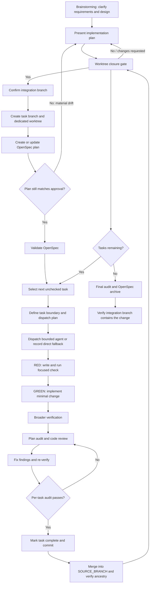

# Development Workflow

The workflow is mandatory by default. Do not treat it as optional guidance. Any
deviation from the workflow is noncompliant **unless the user explicitly opts out**
using one of the phrases in "Explicit User Opt-Outs" below.

Use this skill to enforce a strict development loop. It applies to every code, test,
documentation, configuration, and refactoring task unless the user explicitly provides a
stricter workflow or an explicit opt-out.

## Explicit User Opt-Outs

The user can disable parts of this workflow, or the whole workflow, by stating one of
the following phrases (or a clear equivalent) in the current conversation. Opt-outs
apply only when the user states them explicitly — never assume an opt-out from silence,
task size, or your own judgment.

| User says | Effect |
|---|---|
| "不要 workflow" / "不用 workflow" / "no workflow" | Do not activate this skill at all. Exit immediately and handle the request as an ordinary task. None of the stages, gates, or status formats below apply. |
| "不要 OpenSpec" / "不用 OpenSpec" / "skip OpenSpec" | Skip every OpenSpec stage: no `openspec/changes/` asset, no `openspec validate`, no OpenSpec archive, no `Refs: OpenSpec …` footer. Keep a durable task checklist outside OpenSpec (e.g., the task tracking tool) so progress still survives session breaks. All other stages and gates — branch/worktree setup, TDD, verification, review, per-task commit, final audit — still apply. |
| "不要分支" / "不要 worktree" / "no branch" | Skip task branch and worktree creation. Edit, test, and commit directly on the current branch in the current checkout. Record the current branch name once, and skip merge-back, worktree cleanup, and source-branch integration steps. All other stages still apply. |
| "不用检查" / "不用审计" / "跳过审计" / "no audit" | Skip only the per-task audit gate when the user explicitly says so. All other task gates, including plan-implementation consistency audit, domain review, verification, task marking, commit, and final audit, still apply. |

Rules:

- "不要 workflow" overrides everything, including any other opt-out.
- "不要 OpenSpec" and "不要分支" compose: the user may state both at once.
- An opt-out never relaxes the domain skills (`code-review-spec`,
  `logging-boundaries`, `backend-reliability-guidelines`,
  `frontend-interaction-guidelines`, `project-hygiene`). Opting out of those
  requires the user to name them explicitly.
- Echo every active opt-out in status reports via the `Opt-outs` line.

## Required Sources

Load and follow these skills at their required workflow stages:

- `git-branch-worktree-convention` whenever creating or validating branch names,
  setting up worktrees, recording SOURCE_BRANCH, or enforcing original-checkout
  write protection.
- `project-hygiene` whenever a change initializes a project, adds or removes
  build manifests, introduces new tool, artifact, or binary file types, adds
  environment variable references, or touches baseline files (`.gitignore`,
  `.gitattributes`, `.editorconfig`, `.env.example`).
- `superpowers:brainstorming` for requirement discussion, alternatives, and approved design.
- The action-specific OpenSpec skill suite for durable change assets:
  - `openspec-new-change` with `openspec-continue-change`, or `openspec-ff-change`, for planning.
  - `openspec-apply-change` for implementation.
  - `openspec-verify-change` for implementation verification.
  - `openspec-sync-specs` when approved delta specs must be synchronized.
  - `openspec-archive-change` for archival.
- `superpowers:subagent-driven-development` for bounded multi-agent task execution when tasks can be safely delegated.
- `superpowers:test-driven-development` for RED/GREEN/REFACTOR discipline before production code.
- `superpowers:verification-before-completion` or the closest available Superpowers audit skill for plan-implementation consistency audit.
- `code-review-spec` from `/Users/lvdaxianer/.agents/skills/code-review-spec/SKILL.md`
  whenever a task writes, modifies, reviews, or formats source code.
- `logging-boundaries` from `/Users/lvdaxianer/.codex/skills/logging-boundaries/SKILL.md`
  whenever a task writes, modifies, reviews, tests, or advises on production logging.
- `backend-reliability-guidelines` whenever a task touches backend APIs, services,
  controllers, jobs, queues, webhooks, migrations, configuration, validation,
  authorization, idempotency, transactions, concurrency, error handling, or
  backend observability.
- `frontend-interaction-guidelines` whenever a task touches frontend pages,
  components, forms, modals, lists, dashboards, editors, workflows, buttons,
  loading, empty/error states, submit/save/delete/publish/pay/upload/batch
  actions, debounce/throttle, keyboard behavior, motion, responsive
  interaction, accessibility interaction quality, operation reliability, or
  cross-page state consistency.
- `rest-api-documentation` whenever a task creates or modifies an externally
  exposed Controller or API route. Apply its module-document rules and complete
  the REST API documentation gate before broader verification.
- `commit` from `/Users/lvdaxianer/.codex/skills/commit/SKILL.md`.

The project `openspec/` directory stores change and specification assets; it is
not a skill package. Do not search for or require `openspec/SKILL.md`.

Canonical rule sources used through those pointer skills:

- `/Users/lvdaxianer/.claude/skills/code-review-spec/SKILL.md`
- `/Users/lvdaxianer/.claude/skills/code-review-spec/spec.md`
- `/Users/lvdaxianer/.claude/skills/code-review-spec/references/*`
- `/Users/lvdaxianer/.codex/skills/logging-boundaries/SKILL.md`
- `/Users/lvdaxianer/.claude/skills/logging-boundaries/SKILL.md`
- `rest-api-documentation/SKILL.md`
- `rest-api-documentation/references/api-document-template.md`
- `/Users/lvdaxianer/.claude/commands/commit.md`

If any required source cannot be read, stop and report the missing source.

## Stage Boundaries

- Requirement discussion uses `superpowers:brainstorming`. While the user is still
  clarifying requirements, alternatives, trade-offs, or acceptance criteria, do not
  require OpenSpec files.
- Plan approval is a mandatory user-controlled gate after brainstorming and before
  worktree setup or any task-owned file write. Present the implementation scope,
  task breakdown, acceptance criteria, verification approach, risks, and assumptions,
  then wait for the user to explicitly approve that plan.
- Discussion, silence, acknowledgement, or a request for changes is not approval.
  If the user requests changes, revise the plan and return to the plan-approval
  gate. Do not create a branch, worktree, OpenSpec asset, test, or implementation
  file before explicit approval.
- If the OpenSpec plan or task breakdown materially diverges from the approved plan,
  stop and return to plan approval before continuing.
- Requirement persistence uses OpenSpec. Once the user chooses to write the
  requirement into files, create or update exactly one OpenSpec change for the
  independent change.
- Implementation first defines a task boundary and agent dispatch plan after the
  OpenSpec planning asset has been created and validated, then uses
  `superpowers:test-driven-development`.
- After all planned tasks finish, emit a final audit report that lists completed
  tasks, lists unfinished tasks, and includes a final review summary before the
  workflow is considered fully closed.
- Every task must pass a separate per-task audit after implementation review and
  re-verification and before its checklist item can be marked complete. This is
  a hard gate: the next task, task completion marker, commit, and integration are
  forbidden until the audit passes, unless the user explicitly opts out with one
  of the audit opt-out phrases above.

## Task Worktree Closure Gate

Task branches eligible for this workflow's cleanup MUST match one of these local
branch namespaces:

```text
features/*
fixes/*
```

This allowlist includes names with or without the `✅` marker. These branches
are task branches, not long-lived integration branches. They MUST remain in
their dedicated worktree until the task has passed every required verification
and has been merged into the recorded `SOURCE_BRANCH`. This workflow MUST NOT
delete local branches outside these namespaces or any remote branch.

The commit gate is hard: before `git commit`, the task MUST have passed RED,
GREEN, broader verification, plan-implementation consistency audit,
`code-review-spec`, all applicable domain gates, the per-task audit, the
OpenSpec task marker, and the `project-hygiene` secret/artifact check. A task
branch MUST NOT receive a workflow commit before these conditions pass.

The closure gate is a separate hard gate. Before removing a task worktree or
branch, read `.source_branch` and verify all of the following:

```bash
SOURCE_BRANCH=$(cut -d= -f2 "$TASK_WORKTREE/.source_branch")
TASK_BRANCH=$(git -C "$TASK_WORKTREE" branch --show-current)
test -n "$SOURCE_BRANCH"
case "$TASK_BRANCH" in
  features/*|fixes/*) ;;
  *) echo "task branch is outside cleanup allowlist: $TASK_BRANCH"; exit 1 ;;
esac
test -z "$(git -C "$TASK_WORKTREE" status --porcelain)"
test -z "$(git -C "$SOURCE_CHECKOUT" status --porcelain)"
git -C "$SOURCE_CHECKOUT" merge-base --is-ancestor "$TASK_BRANCH" "$SOURCE_BRANCH"
```

Only when every check succeeds MAY the workflow run:

```bash
git worktree remove "$TASK_WORKTREE"
git branch -d "$TASK_BRANCH"
```

`git worktree remove --force`, `git branch -D`, deleting an unmerged task
branch, deleting a dirty worktree, deleting a branch outside the allowlist, or
deleting a remote branch are prohibited as task closeout actions. A successful
`git worktree remove` MUST remove both the local worktree directory and its Git
worktree registration before `git branch -d` is attempted. If any closure check
fails, report the exact failed condition and preserve the worktree and branch
until the condition is repaired or explicitly resolved.

## Workflow Flowchart



## Domain Authority Delegation

This workflow controls process only. It does not encode standards. Whenever a
task touches a domain listed below, the corresponding skill is authoritative
and must be executed strictly and item-by-item against its canonical sources
(SKILL.md, spec.md, and every applicable `references/*` file). Summaries,
impressions, "close enough", or selective coverage do not satisfy a domain
skill.

| Domain trigger | Authoritative skill |
|---|---|
| Any source code writing, modification, review, or formatting | `code-review-spec` |
| Production logging: log statements, levels, fields, redaction, trace/MDC, DEBUG controls, log-volume behavior | `logging-boundaries` |
| Backend implementation and backend review: APIs, services, jobs, queues, webhooks, migrations, configuration, validation, authorization, idempotency, transactions, concurrency, error handling, observability | `backend-reliability-guidelines` |
| Frontend interaction implementation and review: pages, components, forms, modals, editors, workflows, buttons, loading/empty/error/disabled states, submit/save/delete/publish/pay/upload/batch actions, debounce/throttle, keyboard, motion, responsive interaction, accessibility interaction quality, operation reliability, cross-page state consistency | `frontend-interaction-guidelines` |
| External Controller or API route documentation: public route contract, module grouping, `apis/<module>.md` placement, Controller-to-module coverage | `rest-api-documentation` |
| Project baseline files: `.gitignore`/`.gitattributes`/`.editorconfig`/`.env.example` synchronization, secret-leak prevention, editor and AI tool directory policy | `project-hygiene` |

Delegation rules:

- Read the pointer skill and every canonical source file it requires before
  making decisions in that domain. Do not approximate a rule from this workflow,
  from another skill, or from general knowledge.
- When two domain skills overlap on the same concern, the more specific domain
  wins on that concern (logging concern → `logging-boundaries`;
  frontend-interaction concern → `frontend-interaction-guidelines`;
  backend-reliability concern → `backend-reliability-guidelines`;
  external API documentation concern → `rest-api-documentation`).
  `code-review-spec` continues to govern all non-domain code quality concerns.
- Include the applied domain rules and reference files as evidence in the
  focused test, plan-implementation consistency audit, and `code-review-spec`
  gates for the task.
- If any pointer, canonical skill, or required reference file cannot be read,
  stop the affected task or gate and report the unavailable source. Never
  invent, summarize, or approximate a missing rule.

## OpenSpec Planning Requirements

- Use `superpowers:brainstorming` before writing the plan so the plan captures the intended behavior, constraints, trade-offs, and acceptance criteria.
- Do not create or update OpenSpec assets until the user has explicitly approved
  the implementation plan. The approval brief must cover scope, task breakdown,
  acceptance criteria, verification, risks, and assumptions.
- Treat the approved plan as a contract. If OpenSpec introduces material scope,
  task, acceptance, or verification changes, stop and return to the user plan
  approval gate before continuing.
- Use `openspec-new-change` with `openspec-continue-change`, or use
  `openspec-ff-change`, to create or update the written change asset under
  `openspec/changes/<change-name>/`.
- Before creating or updating the written change asset, verify that the project
  root contains a non-hidden `openspec/` directory. If it is missing,
  initialize the OpenSpec scaffold first and select Codex and Claude instruction targets.
  Hidden `.openspec` paths do not satisfy the project OpenSpec root requirement.
- Future persisted changes and approved specs must be based on the project OpenSpec workflow.
  Keep changes under `openspec/changes/` and approved specs under `openspec/specs/`.
  Non-OpenSpec documents do not replace OpenSpec change/spec assets as the
  authoritative source.
- Use the local OpenSpec `spec-driven` layout:
  - `openspec/changes/<change-name>/.openspec.yaml`
  - `openspec/changes/<change-name>/proposal.md`
  - `openspec/changes/<change-name>/design.md`
  - `openspec/changes/<change-name>/tasks.md`
  - `openspec/changes/<change-name>/specs/<capability>/spec.md`
- Validate the OpenSpec change with `openspec validate <change-name> --strict`.
- The OpenSpec plan is a required project asset. Validate it before implementing
  production code. The workflow does not require a standalone planning commit by
  default.
  OpenSpec planning files are committed with the first atomic task commit that
  carries a complete business module.
- For every new feature or bug fix, create or select a dedicated branch and a
  dedicated project Git worktree as one mandatory setup step before any
  task-owned file is written. Branch naming, worktree paths, SOURCE_BRANCH
  recording, and original-checkout write protection are delegated to
  `git-branch-worktree-convention`. This workflow does not restate those rules.
- The dedicated worktree must be created using the task-branch naming and path
  conventions specified in `git-branch-worktree-convention` (emoji-prefixed
  task branches, `.claude/worktrees/` root). The user confirms the integration
  branch once at the first task; each task starts from and merges back into it.
- The agent must not begin task work until both the required branch and its
  dedicated worktree have been created or selected and the worktree preflight
  checks pass. If the branch is checked out elsewhere, the path is occupied, or
  the current directory is not the selected worktree, stop and repair setup
  before continuing.
- A standalone OpenSpec or documentation commit is allowed only when the change
  is documentation-only or when no business implementation remains to carry the
  document update.
- Every planned task must have one durable checkbox or equivalent status marker. Mark exactly one completed task immediately after its gate passes. Do not batch-complete tasks at the end.
- If a session resumes mid-change, read the OpenSpec task list first, continue from the first unchecked task, and preserve already completed task markers.
- After every OpenSpec change is fully executed and verified, archive the completed OpenSpec change according to the repository's OpenSpec archive process.
- After the final audit and archive flow completes, produce a final audit report
  that lists completed tasks and lists unfinished tasks for the completed change.
  The report format and required topics are delegated to `openspec-archive-change`.
  This workflow does not restate report structure rules.
- After the final audit and OpenSpec archive work pass, return to the clean
  checkout/worktree of the confirmed integration branch. Verify that every
  completed task branch was merged into it and that it contains the change.
  There is no extra parent/feature branch to merge at the end. Merge conflicts,
  a missing source worktree, or unrelated uncommitted source changes are
  blocking conditions; preserve existing work and do not claim completion
  until integration succeeds.

## Risk-Based Standard Change Tiers

OpenSpec remains mandatory by default for every persisted change unless the user
explicitly opts out. Risk tiers only scale evidence depth; they do not remove
OpenSpec traceability, required gate order, task completion markers, commits,
final audit, or OpenSpec archive.

Classify standard changes primarily by behavior risk and secondarily by file
count or module span before implementation:

- S-tier: localized low-risk behavior changes, such as a small bug fix, a local
  validation adjustment, or a narrow test/configuration update. Keep an OpenSpec
  change by default, but use compact proposal, design, task, spec, verification,
  and review evidence. A single task is usually enough. Do not add subagent
  orchestration when the task is better handled directly; record the direct
  execution fallback reason before RED.
- M-tier: normal feature, bugfix, configuration, test, documentation, or
  refactoring changes with clear behavior risk and bounded module impact. Use
  the complete workflow with concise evidence, focused task boundaries, focused
  and broader verification commands, and canonical review. Dispatch subagents
  only when clear ownership boundaries make delegation useful and safe.
- L-tier: broad or risk-sensitive standard changes, including cross-module
  behavior, public contract changes, migrations, permissions, concurrency, data
  consistency, or architecture-boundary work. Use the fullest task breakdown,
  risk notes, verification scope, and review evidence. Prefer smaller task
  commits, reduce implementation concurrency for shared or high-risk areas, and
  run the strongest relevant broader verification.

Tiers scale evidence depth; they do not remove gate order. If the tier is
unclear, choose the higher-risk tier until evidence supports a narrower scope.

## Commit Message Requirements

Commit message format is delegated to the `commit` skill; this workflow does
not restate that standard.

- Every workflow-created commit — task implementations, OpenSpec archives,
  and workflow-driven documentation — MUST invoke `commit --style=full`
  unless the user explicitly requests `--style=simple`. Follow the canonical
  `commit` skill item-by-item; do not accept summaries or "close enough"
  substitutes.
- For OpenSpec-driven task commits, the footer SHOULD carry
  `Refs: OpenSpec <change-name> task <task-id>` so traceability lands on the
  OpenSpec change. All other formatting rules (subject emoji, non-empty
  body/footer, Chinese Conventional Commit style, etc.) are owned by the
  `commit` skill.

## Task Boundary And Agent Dispatch Requirements

Subagent orchestration principles are delegated to
`superpowers:subagent-driven-development` and `dispatching-parallel-agents`;
this workflow does not restate them. The rules below are workflow-local
policy that layers on top of those authoritative skills — task boundary
contents required by this workflow, the merge-review loop this workflow
enforces, and concurrency numbers this workflow caps for safety.

- Before RED, the selected OpenSpec task must define a task boundary and agent
  dispatch plan.
- The task boundary and agent dispatch plan must include:
  - module-oriented agent name
  - owned responsibility
  - allowed files or modules
  - out-of-scope work
  - dependencies
  - focused and broader verification commands
  - handoff evidence
- For a task that creates or modifies an externally exposed Controller/API route,
  the boundary must additionally include the affected public Controllers/routes,
  their business-module mapping, target `apis/<module>.md` files, and the REST
  API documentation coverage check.
- Use `superpowers:subagent-driven-development` as the default multi-agent
  orchestration principle for safely delegable tasks.
- multi-agent orchestration is the default execution principle when task
  boundaries are clear and delegation is safe.
- The main agent remains responsible for planning, context curation, dispatch,
  verification evidence, plan-implementation consistency audit,
  `code-review-spec`, task mark-complete, commits, final audit, OpenSpec
  archive, and final reporting.
- The main agent verifies the returned evidence before advancing gates.
- Direct main-agent execution is allowed only when delegation is unavailable, unsafe, or not useful. The workflow must record the fallback reason before RED.
- Parallel implementation is allowed only with disjoint write scopes or isolated worktrees.
- The workflow does not dispatch multiple implementation agents to edit overlapping files or modules in the same working tree.
- Analysis, review, and verification agents may run in parallel when they do not
  mutate overlapping files.
- The default maximum parallel implementer subagents is 3.
- The default maximum total parallel agents is 5 across implementer, analysis,
  review, and verification agents.
- The concurrency limit is a safety ceiling, not a target. Do not start agents
  only to fill capacity.
- When the limit is reached, queue additional agent work until a running agent
  completes or is closed.
- If a delegated task enters a repair loop, reuse the same subagent for that repair loop instead of starting a new implementer agent.
- For shared files, shared modules, or high-risk changes, reduce implementation concurrency to 1 even when the default limit would allow more agents.
- The subagent merge-review loop is mandatory for delegated implementation:
  merge or apply the subagent result into the task worktree, run main agent
  review, send the findings back to the same subagent when issues exist, and
  repeat merge, review, and fix until the main agent review passes.
- Do not mark delegated work complete from a subagent report alone. The main
  task worktree must contain the merged or applied result before review gates can pass.

## Mandatory Task Loop

For each development task, execute this exact order:

1. Use `superpowers:brainstorming` to clarify the requirement and approve the design.
2. Present the implementation plan to the user, including scope, task
   breakdown, acceptance criteria, verification approach, risks, and assumptions.
   Wait for explicit user approval. If the user requests changes, revise the plan
   and return to this step; do not begin worktree setup, OpenSpec persistence, test
   writing, or implementation before approval.
3. Classify the change as a new feature or bug fix. At the first task, ask the
   user whether the current branch is the change's integration branch. Create
   the correctly named task branch and its dedicated project worktree from that
   confirmed branch, record it as `SOURCE_BRANCH`, then verify the branch,
   worktree path, and current directory. Do not write task files from the
   original checkout. If the change initializes the project or adds/removes
   build manifests, tool or artifact directories, binary file types, or
   environment variable references, run the `project-hygiene` baseline sync
   inside the task worktree before task-owned edits.
4. Use `OpenSpec` from the dedicated worktree to create or update the written
   change, including the OpenSpec plan and task checklist.
5. Validate the OpenSpec change and keep those planning files available for the first related task commit. If the validated plan materially diverges from the approved plan, return to step 2.
6. Select the next unchecked task from the OpenSpec plan. Do not start later tasks early.
7. Define the task boundary and agent dispatch plan for the selected task before writing the failing test.
8. Dispatch a bounded module-oriented implementer agent when delegation is safe; otherwise record the direct-execution fallback reason before writing the failing test.
9. For delegated implementation, merge or apply the subagent result into the task worktree before accepting the task result.
10. Run main agent review on the merged or applied result.
11. If main agent review finds issues, send the findings back to the same subagent and repeat merge, review, and fix until the main agent review passes.
12. Use `superpowers:test-driven-development` and write the smallest useful TDD test for the selected task.
13. Run the focused test and confirm the RED failure is caused by missing behavior.
14. Implement the minimal GREEN change required by the failing test.
15. Run the focused test again and confirm it passes.
16. When the task creates or modifies an externally exposed Controller/API route,
    load `rest-api-documentation`, identify every affected public
    Controller/route and its business module, then create or update exactly one
    target-project module document at `apis/<module>.md` for each affected
    module. Each module document must contain complete endpoint sections for its
    affected public routes; do not create one document per endpoint or
    Controller. If no external Controller/API route is affected, record this
    gate as not applicable.
17. Run the relevant broader test, lint, build, or documentation check for the touched area.
18. Run a plan-implementation consistency audit using Superpowers audit capability. Confirm the implementation matches the OpenSpec plan, acceptance criteria, current task scope, and the REST API documentation coverage result when applicable.
19. Apply `code-review-spec` to the full diff for this task, strictly and item-by-item against the canonical sources.
20. Fix every issue that should be fixed under `code-review-spec`. Do not ask for confirmation
   before making clear quality, correctness, maintainability, performance, or security fixes.
21. Re-run the REST API documentation gate when applicable, plus the focused and broader verification commands after fixes.
22. Run the mandatory per-task audit. Re-check the task boundary, OpenSpec
    acceptance criteria, implementation diff, focused and broader verification
    evidence, all applicable domain rules, REST API documentation coverage when
    applicable, review findings, and implementation drift. Record the audit
    result and evidence. If any item fails, fix it and repeat the audit; do not
    advance to task completion. Only an explicit user audit opt-out may waive
    this gate.
23. Mark exactly one completed task immediately after the per-task audit passes
    in the OpenSpec checklist.
24. Pass the commit gate, then create one atomic Chinese Conventional Commit for
    this task from the dedicated worktree by applying
    `commit --style=full`; the message must include a non-empty body and
    non-empty footer. Include uncommitted related OpenSpec planning files in this
    commit when the task carries a complete business module. Before committing,
    run the `project-hygiene` secret-leak check (`git ls-files`) and confirm no
    artifact, tool-local, or secret file is staged. No workflow commit is allowed
    before this gate passes.
25. After the commit succeeds, switch to the clean checkout of the recorded
   `SOURCE_BRANCH`, verify that the integration checkout is clean, merge the
   task branch with `--no-ff`, and verify `git merge-base --is-ancestor`.
26. Run the task worktree closure gate. Only after the task worktree and
   integration checkout are clean, ancestry verification succeeds, and the
   task branch has been confirmed to match `features/*` or `fixes/*`, may the
   workflow run non-forced `git worktree remove` and `git branch -d`, then
   verify the local worktree directory and Git registration are gone before
   returning to the confirmed integration branch. On failure, preserve both
   worktree and branch and do not start the next task.
27. After all tasks are complete, run a final audit to ensure all planned tasks are complete, all acceptance criteria are satisfied, every applicable external Controller/API route has module-document coverage, and no implementation drift remains.
28. Archive the completed OpenSpec change. If archival modifies repository
   files, create one final dedicated task worktree from the confirmed
   integration branch, commit the archive update, then merge and verify that
   task using the same task-integration loop.
29. After the final audit and OpenSpec archive work pass, return to the
   confirmed integration branch and verify it contains every completed task.
   If the source checkout has unrelated uncommitted changes, a merge conflict,
   or a missing task merge, stop and preserve that work. A failed integration
   must not claim completion.

## Gate Rules

- Do not ask for confirmation when the next action is mandated by this workflow.
- The plan-approval gate is intentionally user-controlled: present the plan and
  wait for explicit approval before taking any implementation-start action.
- Do not treat discussion, silence, acknowledgement, or an unqualified response
  as plan approval. Requested changes return the workflow to the approval gate.
- Do not skip validation, even for small or documentation-only changes.
- Do not create a branch, worktree, OpenSpec asset, test, or implementation file
  before the user has explicitly approved the implementation plan.
- Do not implement production code before the OpenSpec plan has been written and validated.
- Do not write task-owned files or create task commits from the original/current
  checkout. Use a dedicated project worktree paired with the correctly named
  branch, and verify it with `git worktree list --porcelain`,
  `git branch --show-current`, and `pwd` before continuing.
- Do not lose the integration branch identity: ask the user to confirm the
  current branch before the first task, record it as `SOURCE_BRANCH` in every
  task worktree, and use it as the only merge target for that change.
- Do not begin new feature or bug-fix work until the correctly named dedicated
  branch and its project worktree have been created or selected.
- Do not decide, implement, review, test, or approve any domain-triggered work
  until the authoritative domain skill listed in Domain Authority Delegation
  has been read from its canonical sources and its applicable requirements
  have been recorded as evidence. This applies to `code-review-spec`,
  `logging-boundaries`, `backend-reliability-guidelines`,
  `frontend-interaction-guidelines`, `rest-api-documentation`, and
  `project-hygiene`.
- Do not replace a domain skill with a summary, impression, "close enough"
  judgment, or partial rule coverage. Every applicable rule from the
  authoritative domain skill must be checked; any uncovered rule must be
  explicitly accounted for.
- Do not write the RED test before the task boundary and agent dispatch plan has
  been defined.
- Do not continue after material plan drift; return to plan approval and obtain
  explicit approval for the revised scope, tasks, acceptance criteria, or checks.
- Do not use direct main-agent execution without recording why delegation is
  unavailable, unsafe, or not useful.
- Do not run overlapping implementation agents in the same working tree.
- Do not exceed 3 parallel implementer subagents or 5 total parallel agents by
  default; queue extra work instead.
- Do not treat the concurrency limit as a target.
- Do not start a new subagent for a repair loop when the original subagent can
  receive the findings and continue.
- Do not advance delegated work from subagent report alone; first merge or apply
  the subagent result into the task worktree, run main agent review, and send
  findings back to the same subagent until the review passes.
- Do not claim completion until every verified task branch has been merged into
  the confirmed integration branch. A dirty source worktree, missing source
  worktree, or merge conflicts must stop the integration gate and preserve
  unrelated work.
- Do not create a workflow commit from a `features/*` or `fixes/*` task branch
  before the commit gate passes.
- Do not remove a task worktree or branch before the separate closure gate passes:
  the branch must match the cleanup allowlist, both worktrees must be clean,
  `.source_branch` must resolve the merge target, and ancestry must be verified.
- Do not use `git worktree remove --force`, `git branch -D`, or any equivalent
  destructive operation to bypass a failed closure gate.
- Do not delete local branches outside `features/*` or `fixes/*`, and do not
  delete remote branches as part of task closeout.
- Do not create standalone planning commits by default; carry OpenSpec planning
  files with the first atomic task commit for a complete business module.
- Do not create a standalone OpenSpec or documentation commit unless the change
  is documentation-only or no business implementation remains to carry it.
- Do not keep implementation code that was written before a failing test unless the user
  explicitly exempted the task from TDD.
- Do not pass the REST API documentation gate for a task with an affected public
  Controller/API route until every affected route is mapped to a business module,
  each module has exactly one `apis/<module>.md`, and the module document covers
  the required REST API contract for every affected route. Do not create
  endpoint-per-file documentation.
- Do not mark a task complete before RED, GREEN, the applicable REST API
  documentation gate, broader verification, plan-implementation consistency
  audit, `code-review-spec`, fixes, re-verification, and commit gates all pass.
- Do not mark a task complete, commit it, integrate it, or start the next task
  before the mandatory per-task audit passes. The audit must explicitly verify
  the task boundary, acceptance criteria, diff scope, test and broader
  verification evidence, applicable domain rules, REST API documentation where
  applicable, review evidence, and absence of implementation drift. A user must
  explicitly say "不用检查" (or a listed equivalent) to waive only this gate.
- Do not batch-complete tasks at the end. Progress must be durable after every finished task.
- Do not combine unrelated plan tasks into one commit.
- Do not commit unrelated user changes. Preserve existing dirty work that is outside the task.
- Do not commit build artifacts, tool-local files, or secrets; run the
  `project-hygiene` leak check at the commit gate.
- Do not hand-edit the managed blocks of baseline files; when build manifests,
  tool directories, binary file types, or environment variable references
  change, delegate the baseline sync to `project-hygiene`.
- If a gate fails, fix the failure and re-run the same gate before continuing.
- If a clear fix is available during review, make it immediately and verify again.
- If the same blocker prevents progress after repeated attempts, report the blocker with
  exact command output and the affected file path.
- For `code-review-spec`, a gate only passes after every applicable rule has been checked and any uncovered rule has been explicitly accounted for.
- The final audit gate only passes when the OpenSpec checklist, implementation diff, tests, REST API documentation coverage where applicable, and review evidence agree that the planned change is complete.

## Required Status Format

When reporting progress, include the current task and gate:

```markdown
Current task: <task name>
Gate: <brainstorming | plan approval | worktree setup | project-hygiene sync | OpenSpec plan | OpenSpec validation | task boundary and agent dispatch | RED | GREEN | REST API documentation | broader verification | plan-implementation consistency audit | code-review-spec | per-task audit | task mark-complete | commit | source-branch integration | worktree closure | final audit | OpenSpec archive | next task>
Opt-outs: <none | no OpenSpec | no branch | ...>
Evidence: <command or file checked>
```

Keep reports concise. Problems or risks come before summaries.
