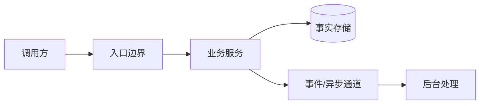

# 视觉表达与架构图规范

本文件只在笔记需要配图、流程图、架构图、数据流、时序或部署视图时读取。视觉内容必须提升理解和验证能力，不以装饰为目标。

## 视觉选择矩阵

| 信息类型 | 首选表达 | 适用条件 | 不要做什么 |
| --- | --- | --- | --- |
| 概念定义和边界 | 文字、表格 | 关系少且可线性阅读 | 用抽象图片替代定义 |
| 层级和阅读入口 | 索引、树形列表 | 需要导航多个主题 | 生成没有链接的海报 |
| 流程和状态 | Mermaid flowchart/state 或步骤表 | 顺序、分支、状态变化重要 | 省略失败路径 |
| 组件和数据流 | Mermaid graph/flowchart | 架构关系需要审查和更新 | 只给一张不可编辑 PNG |
| 调用时序 | Mermaid sequenceDiagram | 时间顺序和责任边界重要 | 把同步/异步关系画混 |
| 部署拓扑 | Mermaid graph 或文本图 | 环境、边界和连接需要核验 | 把推测的基础设施当事实 |
| 场景直觉 | 生成概念图 | 视觉能帮助理解抽象关系或使用情境 | 生成与正文无关的装饰图 |

如果表格或文字已经完整表达信息，不生成图片。复杂架构可以同时保留正文、Mermaid 图源和派生 SVG/PNG。

## 架构图工作流

1. 从需求和已有笔记提取组件、职责、边界、方向、协议/数据、时序和关键约束。
2. 先写组件清单和关系清单，标出事实、假设和待确认项。
3. 选择最小图型：关系图表达边界和依赖，流程图表达路径，时序图表达调用顺序，部署图表达环境拓扑。
4. 先产出 Mermaid/文本图源，再补正文解释每个组件为什么存在、连接传递什么、失败时如何处理。
5. 只有用户明确需要图片展示或 Markdown 渲染需要时，才从图源生成 SVG/PNG；图源始终保留。
6. 完成后逐项对照：图中的组件、连接、方向、约束和正文是否一致；不确定内容用“待确认”标注，不凭空补全。

最小架构图必须能回答：谁负责什么、谁调用谁、数据向哪里流、边界在哪里、关键约束是什么。一个只有方框和箭头、没有职责和方向的图不算完成。

## Mermaid 约定

- 节点名称使用项目真实术语；未知组件不得伪造具体产品名。
- 用子图或边界节点表示系统、信任域、项目和公共知识等范围。
- 连线方向必须表达实际流向；标签说明请求、事件、数据或控制关系。
- 不把“可能”“计划”“已实现”混在同一图层；必要时用图注区分状态。
- 图下方写图源用途、关键假设和读者应关注的关系。

## 概念配图与图像生成

图像生成提示词由四部分组成：主题事实、视觉目的、构图/风格、排除项。优先生成能解释机制、层级、场景或对比的图；不要让模型生成架构事实、接口名称、精确数据或不可验证文字。

生成能力可用时：

- 先确定图片解释的一个问题，不把多个不相关概念塞进一张图。
- 使用项目已有的图片资源目录和命名规则；没有规则时使用笔记相邻的最小资源目录。
- 在 Markdown 中使用有效的相对路径、描述性替代文本和一句用途说明。
- 若图片包含不确定或隐喻内容，在图注中标明“概念示意”，不能当作系统事实。

生成能力不可用时：

- 不声称图片已生成，不创建伪造的二进制文件或链接。
- 保留可执行的提示词，并用 Mermaid、表格或文本结构提供可读替代。
- 在变更报告中说明缺少的工具和后续生成位置。

## 资源与一致性检查

- 图片和图表引用使用项目内可解析的相对路径。
- 每个被引用资源都存在；没有被任何笔记引用的新增资源要么接入索引，要么报告为待清理资源。
- 架构图图源、派生图片和正文中的组件/关系保持一致。
- 修改组件、边界或数据流时，同时更新图源、图注、正文和相关索引。
- 检查替代文本是否说明图片解释的内容，而不是只写“架构图”或“配图”。
